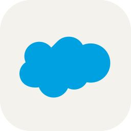

  

<h2> 안녕하세요, Salesforce와 웹 서비스를 함께 만드는 개발자 이용하입니다.</h2>

<a href="https://leeyongha2006.github.io"><b>포트폴리오 사이트 바로가기 →</b></a>&nbsp; leeyongha2006.github.io

 

## About Me

 

## Tech Stack

  
  

#### Salesforce

     
    

#### Web · App

       
        

#### AI 활용

      
  

#### 콘텐츠 · 마케팅

   
 

#### Tools

       

 

## Core Skills

 

## Work · Salesforce

고3 때 DKBMC에 Salesforce 개발자로 입사했습니다. 
첫 업무로 OData 4.0 작업을 시작했고, 이어서 SRM(구매 관리)의 공급자 등록 요청을 개발한 뒤 SRM 전체를 맡게 되었습니다. 
그 과정에서 사내 솔루션(알림 · 게시판 · 위키)의 고도화와 패키징, SRM 모듈 분리, AI 에이전트와 MCP 서버까지 경험하며 역량을 넓혀 가고 있습니다.

회사 코드는 공개할 수 없어, 각 저장소에는 정리 문서와 핵심 구조를 직접 다시 구현한 예제 코드를 담았습니다.

| 프로젝트 | 한 일 | 기간 |
|---|---|:---:|
| [SRM 모듈 패키징](https://github.com/leeyongha2006/srm-modular-packaging) | 구매 관리 솔루션을 2GP 패키지 16개로 분리 | 2026.09⁠–⁠10 |
| [업무 에이전트와 MCP 서버](https://github.com/leeyongha2006/srm-ai-agent-mcp) | 업무 에이전트와 MCP 서버를 Apex로 구현 | 2026.08⁠–⁠10 |
| [알림 프레임워크 V3](https://github.com/leeyongha2006/salesforce-notification-framework) | 다국어 발송, 중복 발송 버그 해결, 패키징 | 2026.05⁠–⁠09 |
| [SRM E2E 테스트 자동화](https://github.com/leeyongha2006/srm-e2e-test-automation) | 10개 업무 모듈 회귀 테스트 207개 통과 | 2026.07 |
| [리스크 대시보드](https://github.com/leeyongha2006/srm-risk-supply-chain-dashboard) | 임원용 대시보드 3종, 공급망 사각지대 탐지 | 2026.07⁠–⁠08 |
| [게시판, 위키 패키지](https://github.com/leeyongha2006/salesforce-board-wiki-package) | 2GP 패키징, 네임스페이스와 포털 문제 해결 | 2026.01⁠–⁠09 |

 

## Side Projects · Web · App · AI

회사 업무가 손에 익은 뒤로는 퇴근 후와 주말에 평소 써 보고 싶던 기술로 직접 서비스를 만들어 보고 있습니다. 
아이디어에서 끝내지 않고 기획부터 개발, 배포, 운영까지 혼자 또는 팀으로 끝까지 해 보는 것을 목표로 합니다.

| 프로젝트 | 한 일 | 기술 |
|---|---|---|
| [사주잇](https://github.com/leeyongha2006/sajuit) · [sajuit.me](https://sajuit.me) | AI 사주 운영 서비스(팀). 결제 · 인증 · 콘텐츠 개발부터 AI 광고 영상, 릴스 · 스레드 마케팅까지 대부분 담당 | React, TypeScript, Supabase, Toss Payments |
| 쇼츠 자동 제작 (비공개 · 운영 중) | 대본, 음성, 영상 생성부터 예약 업로드까지 자동화 | Python, Gemini |
| [최애친구 랭킹](https://github.com/leeyongha2006/choeae-ranking) | 카카오톡, 인스타그램 대화로 친한 친구 TOP 5 분석 | JavaScript, Claude API |
| 구독 관리 앱 (비공개) | 구독 관리, 결제일 알림, 월별 리포트 | React Native, Supabase |

 

## School Projects

> 고등학교 수업과 방과후 과정에서 만든 프로젝트입니다. 
> 지금 보면 부족한 부분이 많지만, 처음 코드를 배우던 때부터 지금까지 어떻게 성장해 왔는지 기록으로 남겨 두고 싶어 함께 정리했습니다. 
> 너그럽게 봐 주시면 감사하겠습니다.

| 시기 | 분야 | 배운 것 | 프로젝트 |
|:---:|---|---|---|
| 2024 | JavaScript | DOM 조작, 이벤트 처리, API 호출을 작은 앱으로 반복 연습 | [계산기](https://github.com/leeyongha2006/Calculator) · [캘린더](https://github.com/leeyongha2006/Calendar) · [스톱워치](https://github.com/leeyongha2006/Stopwatch) · [이미지 검색](https://github.com/leeyongha2006/Image-Search-App) · [컬러 피커](https://github.com/leeyongha2006/Color-Picker) · [드럼 키트](https://github.com/leeyongha2006/Drum-Kit) · [주사위 시뮬레이터](https://github.com/leeyongha2006/Dice-Roll-Simulator) · [비밀번호 생성기](https://github.com/leeyongha2006/Random-Password-Generator) · [다크 모드 전환](https://github.com/leeyongha2006/dark-mode-toggle) · [디지털 시계](https://github.com/leeyongha2006/Digital-Clock) · [아날로그 시계](https://github.com/leeyongha2006/Clock) · [랜덤 컬러](https://github.com/leeyongha2006/Random-Color) · [이중 랜딩 페이지](https://github.com/leeyongha2006/double-landing-page) |
| 2024 | HTML/CSS | 취업맞춤반 방과후 수업에서 웹 화면 구성 | [취업맞춤반 방과후 과제](https://github.com/leeyongha2006/2024_get_a_job) |
| 2023 | Java | 클래스 설계, JavaFX 화면, DB 연동으로 첫 프로그램 완성 | [키오스크](https://github.com/leeyongha2006/Javafx-Kiosk) · [백신 예약](https://github.com/leeyongha2006/Vaccine-Reservation-Program) · [지역구 의원 투표](https://github.com/leeyongha2006/Local-Ward-Council-Voting-Program) · [진단 검사](https://github.com/leeyongha2006/diagnostic-test-program) · [회원가입 화면](https://github.com/leeyongha2006/JavaFx-Member) · [숫자 야구](https://github.com/leeyongha2006/java-baseballgame) |
| 2023 | JSP/DB | JSP와 Oracle로 회원가입 같은 웹 기능, SQL 조인 | [쇼핑몰 회원가입](https://github.com/leeyongha2006/Shoppingamll) · [DB 연결 회원가입](https://github.com/leeyongha2006/DBConnection) · [JSP 첫걸음](https://github.com/leeyongha2006/jsp-first) · [JSP 두걸음](https://github.com/leeyongha2006/Jsp-second) · [SQL 조인](https://github.com/leeyongha2006/DB-SQL-Join) |
| 2023 | 자료구조 | 트리와 선형 구조를 Java로 직접 구현 | [이진 트리](https://github.com/leeyongha2006/Java-Binary-Tree) · [선형 구조](https://github.com/leeyongha2006/Java-Linear-structure) |
| 2023 | HTML | 처음 만든 웹 페이지 | [나이키 소개 사이트](https://github.com/leeyongha2006/html-nike-Intruduce) |

 

## Contact

  
  
  

  

